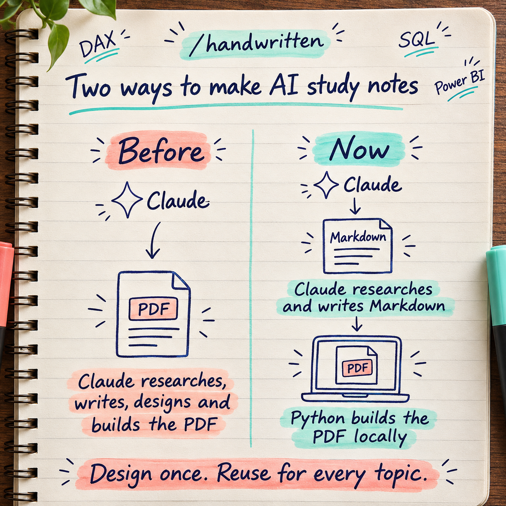
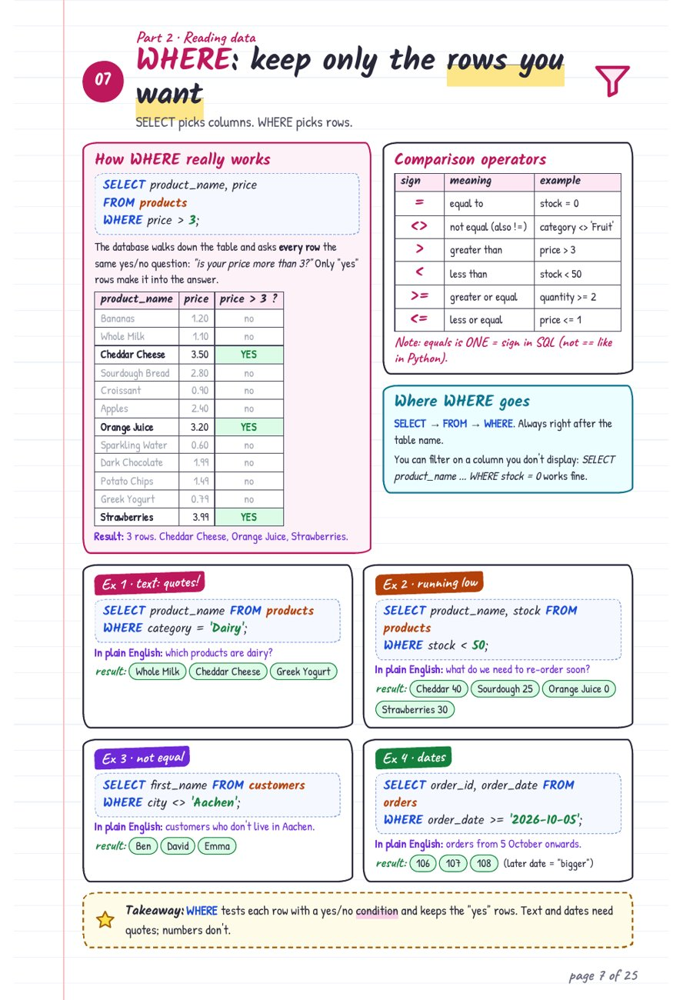
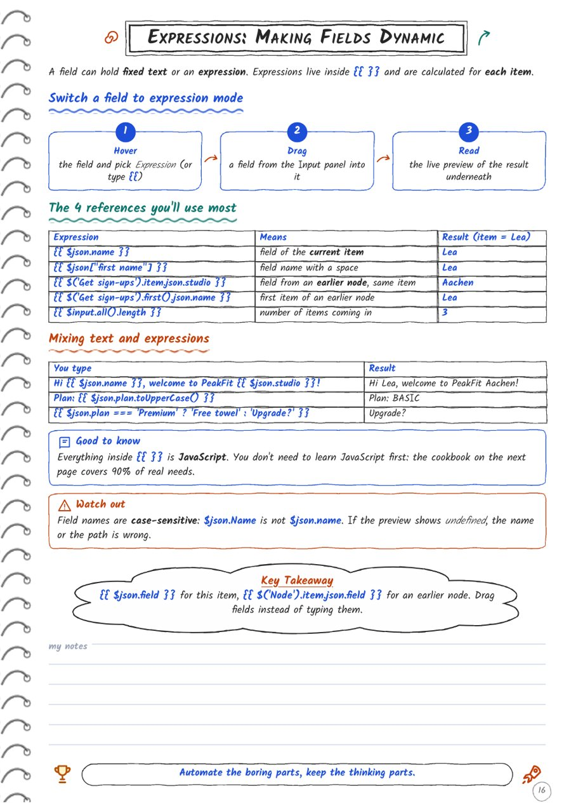

# Handwritten Notes Maker: two ways to make AI study notes

Everyone shares those beautiful handwritten study notes. This folder holds the two ways I made mine for interview prep, and why I switched.

Full write-up: [Learning Log #1 on my website](https://vgs1004.github.io/blog/2026/11/learning-log-01-handwritten-notes/)

## What's in this folder

| Folder | What it is |
|---|---|
| [Method 1 (One Long Prompt)](Method%201%20%28One%20Long%20Prompt%29/) | The single prompt I used for every topic, and the SQL notes it produced |
| [Method 2 (Python Notebook)](Method%202%20%28Python%20Notebook%29/) | The notebook, its format guide, the content prompt, an installation guide, and the n8n notes it produced |

## Method 1: one long prompt, Claude makes the whole PDF

I gave Claude the same long prompt for every topic ([prompt.txt](Method%201%20%28One%20Long%20Prompt%29/prompt.txt)). It asks Claude to check official documentation, teach the topic from zero, and make a PDF that looks like handwritten notes in a spiral notebook, using as many pages as needed.

Claude researches, writes, designs and builds the PDF, all in one go. The result can look great ([SQL notes, 25 pages](Method%201%20%28One%20Long%20Prompt%29/SQL%20Notes%20%28Method%201%29.pdf)), but:

- **Every topic repeats the whole job**, including the design work, so it uses a lot of tokens.
- **Any fix means another full run.**
- **The look changes from topic to topic.**

## Method 2: the design is fixed, Claude writes only the content

1. **The design is fixed once** in a Python notebook: fonts, colours, layout.
2. **Claude writes only the content**, in plain Markdown, using official docs as sources. This is the only step that uses tokens.
3. **The notebook builds the PDF on my laptop:** Markdown to HTML (HTML lines the text up properly), then HTML to PDF. Free, and the same look every time.

Result: [n8n notes, 42 pages](Method%202%20%28Python%20Notebook%29/n8n%20Notes%20%28Method%202%29.pdf).

## What I learned

- **Separate content from design**, like a template in Word or a theme in Power BI.
- **Use the AI only where it adds value.** Writing the content needs Claude. Building the PDF doesn't.
- **You don't need to be a developer.** I built the notebook by describing what I wanted to Claude and checking each page.
